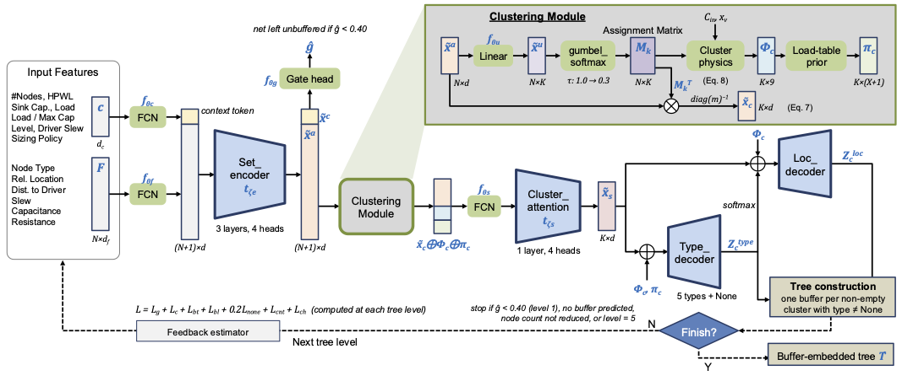

# MLBuf: Recursive Learning-Based Virtual Buffering for Analytical Global Placement 

An open-source learning-driven virtual 
buffering-aware analytical global placement framework, 
built on top of the OpenROAD infrastructure.

## Papers

- **Revised version (with MLBuf v2):** [arXiv:2506.17247](https://arxiv.org/abs/2506.17247). 


- **MLCAD 2025 version:** [PDF](https://vlsicad.ucsd.edu/Publications/Conferences/416/c416.pdf). Its MLBuf-RePlAce and Ad-Hoc results in Tables IV and V are superseded (see the notice below). 
<!-- 

[Paper link](https://arxiv.org/pdf/2506.17247)
[The original version](https://vlsicad.ucsd.edu/Publications/Conferences/416/c416.pdf) (MLCAD25) -->


## Important Notice: MLBuf v2 (November 2026)

This version replaces the MLCAD25 release. It fixes the unit conversion issue reported in [Issue #6](https://github.com/ABKGroup/MLBuf_MLCAD/issues/6) and provides a retrained model, **MLBuf v2**.

What is fixed:
- **Unit conversion.** Predicted buffer boxes (microns) are converted to DBU before their area is reserved in the placer. 
- **Model.** MLBuf v2 is trained with unbuffered nets as negative samples and can predict "no buffer" for a net. 
- **Net weights.** MLBuf-RePlAce keeps the slack-based net weights of TD-RePlAce. 
- **Reproducibility.** Inference is deterministic. The Ad-Hoc baseline is seeded.

The MLBuf-RePlAce and Ad-Hoc results in Tables IV and V of the MLCAD25 paper were produced with the unit conversion issue and are superseded. Updated results are reported in the revised [arXiv paper](https://arxiv.org/pdf/2506.17247). The MLCAD25 release remains available at commit `a10d262`.

We sincerely thank Cezar Trisca Vicol and his colleagues at Partcl for identifying and reporting this issue.


## Code Structure
```bash
MLBuf/   
├── data/                     # Data
│   ├── buf_data.csv          # Buffer information
│   ├── feedback_estimator.json # Feature update coefficients
│   ├── DATA.md               # Data card of the training data (sources, provenance, schema)
│   └── training_data         # Bundled subset of the training data (ibex_apr2025, jpeg_apr2025_run2)
├── mlbuf2/                   # MLBuf v2 
│   ├── schema.py             # Parse the training dataset
│   ├── sources.py            # Paths and training data sources
│   ├── build_dataset.py      # Build net records (buffered and unbuffered nets)
│   ├── calibrate_feedback.py # Refit the feature update of upper recursion levels (optional)
│   ├── levels.py             # Features and labels of each recursion level
│   ├── physics.py            # Buffer library and feature update
│   ├── dataset.py            # Load dataset
│   ├── model.py              # MLBuf v2 model
│   ├── losses.py             # Loss functions
│   ├── train.py              # Model training
│   └── infer.py              # Model inference
├── configs/                  # Training configurations
│   ├── mlbuf_v2.yaml         # smoke test on the bundled subset
│   └── mlbuf_v2_full.yaml    # recipe of the released model (needs the complete training data)
├── results/                  # Model results 
├── scripts/                  # Scripts for global placement and evaluation
│   ├── invs_scripts          # Commercial tool scripts for generating post-route results 
│   └── OR_scripts            # OpenROAD scripts for global placement and ORFS evaluation
├── train.py                  # Entry point for training the model
├── requirements.txt          # Dependencies for model training and inference
├── env_or.sh                 # Environments for OpenROAD and ORFS 
├── OR_branch_integration/    # MLBuf-RePlAce
│   ├── mlbuf_infer.py        # MLBuf v2 inference called by the placer
│   └── adhoc_baseline.py     # Ad-Hoc baseline for comparison
├── OR_inputs/                # Designs & platform
├── LICENSE                   # License
└── README.md                 # Project documentation
```

## Training MLBuf

Python 3.9 to 3.12 (torch 2.3.0 has no wheels for 3.13); `pip install -r requirements.txt` (CPU-only torch: add `--extra-index-url https://download.pytorch.org/whl/cpu`).

**torch version.** requirements.txt pins `torch==2.3.0`, the version used for the released model and placements. With torch 2.3.0 the shipped `.def`/`.odb` files are reproduced bit-exactly; with other versions the placement and the downstream results are equivalent but not identical.

**Smoke test** on the two dump sets bundled with the repository (ibex, jpeg; `data/training_data/`):
```bash
python train.py   # = python train.py configs/mlbuf_v2.yaml [--gpu N]
```
The resulting model is much weaker than the released one, because it has seen only two designs (ibex and jpeg). Use it to check the installation, not as a replacement for `mlbuf-v2.pt`.

**Reproducing the released model** `results/model_dict/mlbuf-v2.pt`. It was trained on 11 dump sets of ibex, jpeg,
ariane133, ariane136, black_parrot and bsg_chip (17.5 GB; 1.8 GB as tar.gz). The complete training data is available on Google Drive:
[MLBuf v2 training data](https://drive.google.com/drive/folders/1uprj0g7dzjtwjMCDRIP1jfrt0S7VGP9j?usp=sharing).
```bash
pip install gdown
gdown --folder "https://drive.google.com/drive/folders/1uprj0g7dzjtwjMCDRIP1jfrt0S7VGP9j" -O mlbuf_v2_training_data
cd mlbuf_v2_training_data
sha256sum -c CHECKSUMS.sha256                      # verify the archives
for f in *.tar.gz; do tar -xzf "$f"; done          # -> <source>/buffered_trees_{pre,post}_*.csv
sha256sum -c MANIFEST.sha256                       # verify the extracted files
export MLBUF_TRAINING_DATA=$PWD
cd /path/to/MLBuf_MLCAD
python train.py configs/mlbuf_v2_full.yaml --gpu 0
```


Results are written to `results/<config name>/`:
```bash
results/
├── model_dict/     # released model mlbuf-v2.pt
├── mlbuf_v2/       # smoke test: model_best.pt, model_last.pt, log.csv, best_val.json
└── mlbuf_v2_full/  # reproduction of the released model
```


## Integrating MLBuf into OpenROAD for MLBuf-RePlAce
1. **Build OpenROAD** in the OR_branch_integration directory using the version [OpenROAD (mlbuf-v2 branch)](https://github.com/ytliu8464/OpenROAD_MLBuf/tree/mlbuf-v2) 
```bash
cd OR_branch_integration
git clone --recursive --branch mlbuf-v2 https://github.com/ytliu8464/OpenROAD_MLBuf.git OpenROAD
cd OpenROAD
mkdir build && cd build
cmake ..
make -j "$(nproc)"
```

***Note: To fully reproduce results, ensure the execution environment for OpenROAD and ORFS matches ours. The environment setup is provided in env_or.sh.***

2. Run **MLBuf-RePlAce**

Five NanGate45 designs are set up under `scripts/OR_scripts/<DESIGN_NAME>`, with their ORFS inputs (floorplan, IO placement, SDC) under `OR_inputs/<DESIGN_NAME>`:

| DESIGN_NAME | ORFS design | clock period  | in the MLBuf v2 training data |
|---|---|---|---|
| ibex | ibex | 2.2 ns | yes |
| jpeg_encoder | jpeg | 1.4 ns | yes |
| swerv_wrapper | swerv_wrapper | 2.0 ns  | no |
| tinyRocket | tinyRocket | 1.4 ns  | no |
| dynamic_node | dynamic_node | 5.5 ns |  no |

ibex and jpeg_encoder are the designs of the MLCAD'25 paper; the other three were added for the revised results. 
<!-- tinyRocket's two fakeram macros have no liberty model during global placement (the ORFS flow loads it downstream); this is how the reported results were produced. -->

```bash
cd scripts/OR_scripts/${DESIGN_NAME}
./run_mlbuf.sh
```
Set `MLBUF_PYTHON` to the Python interpreter that has the packages in requirements.txt (default: `python`). Use torch 2.3.0 to reproduce the shipped placements bit-exactly (see [Training MLBuf](#training-mlbuf)).

Check that buffer area is reserved at every timing-driven iteration:
```bash
python ../check_reservation.py run_replace_mlbuf_mlbuf-v2.log
```

3. (Optional) Run baseline comparisons:

- **Ad-Hoc Baseline**
```bash
./run_baseline_adhoc.sh
```
- **RePlAce** (no timing-driven mode)
```bash
./run_baseline_no_timing.sh
```
- **TD-RePlAce** (default virtual buffering-based timing driven global placement in OpenROAD)
```bash
./run_baseline_rsz_virtual.sh
```
4. **Global placement results**

The global placement results (both .def and .odb) are generated in:
```bash
scripts/OR_scripts/${DESIGN_NAME}/mlbuf-v2/${DESIGN_NAME}_mlbuf.odb   # MLBuf-RePlAce
scripts/OR_scripts/${DESIGN_NAME}/${DESIGN_NAME}_rsz_adhoc.odb        # Ad-Hoc baseline
scripts/OR_scripts/${DESIGN_NAME}/${DESIGN_NAME}_no_timing.odb        # RePlAce
scripts/OR_scripts/${DESIGN_NAME}/${DESIGN_NAME}_rsz_virtual.odb      # TD-RePlAce
```
We also provide .odb global placement results generated by MLBuf-RePlAce, Ad-Hoc baseline, RePlAce and TD-RePlAce in the same directory.

## Evaluation

To generate post-route results, use the global placement results as the starting point for downstream flows in **OpenROAD-flow-scripts (ORFS)**.

**Steps:**

1. Set up **OpenROAD-flow-scripts (ORFS)** using the version [ORFS (mlbuf-orfs-v2 branch)](https://github.com/ytliu8464/OpenROAD-flow-scripts/tree/mlbuf-orfs-v2) 
```bash
git clone --branch mlbuf-orfs-v2 https://github.com/ytliu8464/OpenROAD-flow-scripts.git
```

2. Run the automation script to generate post-route results (ORFS calls `python3` from PATH and needs PyYAML, so activate the environment of requirements.txt first):
```bash
export FLOW_HOME=/path/to/OpenROAD-flow-scripts/flow
scripts/OR_scripts/run_orfs.sh ${DESIGN_NAME} ${METHOD}
```
- **DESIGN_NAME**: ibex, jpeg_encoder, swerv_wrapper, tinyRocket, dynamic_node
- **METHOD**: mlbuf, adhoc, no_timing, rsz_virtual

3. After the run completes, the script prints WNS, TNS, power and routed wirelength. All metrics are available in:
```bash
scripts/OR_scripts/${DESIGN_NAME}/orfs_${METHOD}/logs/nangate45/*/run/*.log
```

Run-to-run differences of a few ns of TNS are within the flow's sensitivity to sub-site placement perturbations on every design; see the per-design standard deviations in the revised paper.

***Note: To fully reproduce results, ensure the execution environment for OpenROAD and ORFS matches ours. The environment setup is provided in env_or.sh.***


## Reference
Please cite our work if you find our code useful.
```bash
A. B. Kahng, Y. Liu and Z. Wang, 
"Recursive Learning-Based Virtual Buffering for Analytical Global Placement", 
Proc. ACM/IEEE Intl. Symp. on Machine Learning for CAD (MLCAD), 2025. 
```
